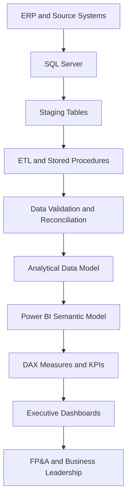
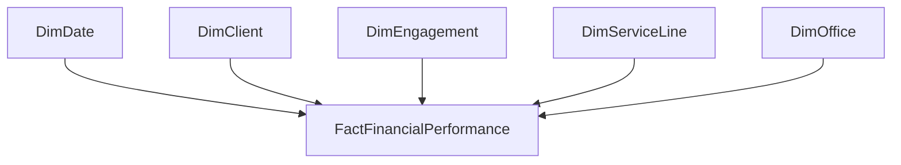

# FP&A Financial Performance Analytics

### End-to-End Financial Analytics & Business Intelligence Solution


---

## Project Overview

This project demonstrates an end-to-end financial analytics
solution designed to support Financial Planning & Analysis
(FP&A), Finance teams and business leadership.

The solution consolidates financial and operational data into
a centralized analytical model, enabling stakeholders to monitor
revenue, gross margin, realization, profitability, write-offs,
accounts receivable and work in progress.

The project focuses on automated reporting, standardized KPI
definitions, data accuracy and actionable financial insights.

---

## Business Impact

The solution is designed to support:

- Improved visibility into financial performance.
- Standardized financial KPI definitions.
- Reduced dependency on manual reporting.
- Improved reporting accuracy and consistency.
- Identification of revenue and profitability gaps.
- Better financial and operational decision-making.
- Efficient month-end reporting and performance reviews.

---

## Problem Statement

Financial data is often distributed across multiple source
systems, transactional tables and manual reports.

This creates challenges such as:

- Limited consolidated visibility into financial performance.
- Time-consuming manual reporting processes.
- Inconsistent KPI calculations across reports.
- Difficulty identifying revenue and profitability trends.
- Limited visibility into outstanding AR and WIP balances.
- Data reconciliation and reporting accuracy challenges.

---

## Business Objectives

- Develop a centralized financial reporting solution.
- Automate data extraction and transformation processes.
- Standardize financial and operational KPI calculations.
- Monitor revenue, costs, margins and realization.
- Identify underperforming engagements and business units.
- Analyze financial performance across multiple dimensions.
- Provide interactive executive dashboards.

---

## Data Overview

### Data Sources

- Financial transaction data
- Engagement and project data
- Client master data
- Employee and resource data
- Billing and invoice data
- Accounts receivable data
- Work in progress data
- Payment and adjustment data
- Organizational hierarchy data

### Data Granularity

- Engagement-level financial performance
- Client-level financial performance
- Monthly financial reporting
- Service line and business unit performance

---

## Solution Architecture



---

## Technology Stack

| Technology | Purpose |
|---|---|
| SQL Server | Data storage and extraction |
| T-SQL | Data transformation and analysis |
| Stored Procedures | ETL and reporting automation |
| Power BI | Interactive dashboards |
| DAX | KPI and business calculations |
| Power Query | Data preparation |
| Excel | Validation and reconciliation |
| GitHub | Version control and documentation |

---

## Data Model

The analytical solution uses dimensional modeling
principles to support scalable financial reporting.

### Representative Fact Tables

| Table | Description |
|---|---|
| FactFinancialPerformance | Revenue, costs and profitability |
| FactAccountsReceivable | Outstanding invoices and AR balances |
| FactWIP | Work in progress balances |
| FactPayments | Payments and cash collections |
| FactWriteOffs | Financial write-offs and adjustments |

### Representative Dimension Tables

| Table | Description |
|---|---|
| DimDate | Calendar and financial reporting periods |
| DimClient | Client master information |
| DimEngagement | Engagement and project details |
| DimEmployee | Employee master information |
| DimServiceLine | Service line classification |
| DimOffice | Office and location information |

### Semantic Model



---

## Implementation Approach

### 1. Business Requirement Analysis

- Understand financial reporting requirements.
- Identify important financial and operational KPIs.
- Define reporting granularity and business dimensions.
- Standardize metric definitions.

### 2. Data Extraction

- Extract financial data using SQL.
- Integrate data from multiple source tables.
- Identify relevant financial transactions.
- Apply reporting period filters.

### 3. Data Transformation

- Develop SQL-based transformation logic.
- Use joins, CTEs and window functions.
- Aggregate financial transactions.
- Handle null values and duplicate records.
- Apply financial business rules.

### 4. ETL and Reporting Automation

- Develop reusable stored procedures.
- Automate staging table updates.
- Implement incremental processing where applicable.
- Standardize monthly reporting workflows.

### 5. Data Quality and Validation

- Perform source-to-target reconciliation.
- Validate financial totals.
- Identify missing and duplicate records.
- Check reporting period consistency.
- Validate KPI calculations against source reports.

### 6. Data Modeling

- Design fact and dimension tables.
- Establish appropriate table relationships.
- Develop a Power BI semantic model.
- Optimize the model for analytical reporting.

### 7. Dashboard Development

- Develop reusable DAX measures.
- Create interactive financial dashboards.
- Implement drill-down and filtering capabilities.
- Present financial trends and performance indicators.

---

## Key Performance Indicators

| KPI | Business Definition |
|---|---|
| Net Revenue | Revenue after applicable adjustments |
| Gross Margin | Net revenue less direct costs |
| Gross Margin % | Gross margin as a percentage of revenue |
| Realization % | Realized revenue relative to standard billable value |
| Direct Cost | Costs directly associated with service delivery |
| Write-offs | Amounts written off according to financial rules |
| AR Balance | Outstanding customer receivables |
| WIP Balance | Value of work performed but not yet billed |
| Cash Collections | Payments received from customers |
| Revenue Growth % | Change in revenue compared with a prior period |

---

## Sample DAX Measures

The following examples demonstrate representative
financial calculations.

### Total Revenue

```dax
Total Revenue =
SUM(FactFinancialPerformance[NetRevenue])
```

### Total Direct Cost

```dax
Total Direct Cost =
SUM(FactFinancialPerformance[DirectCost])
```

### Gross Margin

```dax
Gross Margin =
[Total Revenue] - [Total Direct Cost]
```

### Gross Margin %

```dax
Gross Margin % =
DIVIDE(
    [Gross Margin],
    [Total Revenue],
    0
)
```

### Realization %

```dax
Realization % =
DIVIDE(
    [Total Revenue],
    SUM(FactFinancialPerformance[StandardBillableValue]),
    0
)
```

### Previous Year Revenue

```dax
Previous Year Revenue =
CALCULATE(
    [Total Revenue],
    SAMEPERIODLASTYEAR(DimDate[Date])
)
```

### Revenue Growth %

```dax
Revenue Growth % =
DIVIDE(
    [Total Revenue] - [Previous Year Revenue],
    [Previous Year Revenue]
)
```

---

## Dashboard Pages

### Executive Financial Overview

- Total revenue
- Gross margin
- Gross margin percentage
- Realization percentage
- Revenue trends
- Financial performance by service line

### Revenue and Profitability Analysis

- Client-level revenue
- Engagement-level profitability
- Revenue contribution
- Direct cost analysis
- Margin trends

### Accounts Receivable and WIP

- Outstanding receivables
- WIP balances
- AR aging
- Cash collections
- Write-off analysis

### Financial Trend Analysis

- Monthly financial performance
- Year-over-year revenue growth
- Period-over-period comparisons
- Financial variance analysis

---

## Dashboard Preview

<!-- Add actual dashboard screenshots here. -->

<!--


-->

---

## Business Insights

The solution supports analysis of:

- Revenue contribution across clients and service lines.
- Engagements with lower profitability.
- Differences in realization across business units.
- Revenue and direct cost trends.
- Outstanding AR and WIP balances.
- Financial performance across reporting periods.
- Potential opportunities for improving profitability.

---

## Data Quality and Governance

- Source-to-target reconciliation
- Duplicate record validation
- Missing value checks
- Financial total validation
- Standardized KPI definitions
- Reporting period validation
- Documented business rules
- Data model relationship validation

---

## Repository Structure

```text
fpa-financial-performance-analytics/
│
├── README.md
├── datasets/
├── sql/
├── powerbi/
├── architecture/
├── screenshots/
└── documentation/
```

---

## Skills Demonstrated

- Advanced SQL and T-SQL
- Financial Analytics and FP&A
- Power BI Dashboard Development
- DAX and Power Query
- ETL and Reporting Automation
- Dimensional Data Modeling
- Data Quality and Reconciliation
- Business Intelligence
- KPI Development
- Financial Performance Analysis

---

## Conclusion

This project demonstrates how financial and operational
data can be transformed into a centralized business
intelligence solution.

By combining SQL-based data processing, dimensional
modeling and Power BI visualization, the solution
supports financial performance monitoring, profitability
analysis and data-driven decision-making.

---

## Author

**Jaydeep Hanumante**

Data & Business Intelligence Professional |
Microsoft Certified: Fabric Data Engineer Associate (DP-700)

[GitHub Profile](https://github.com/JaydeepHanumante)
